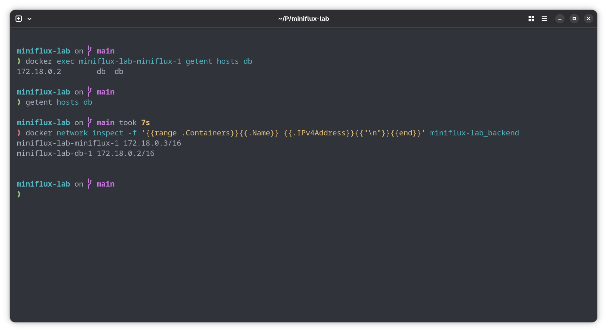
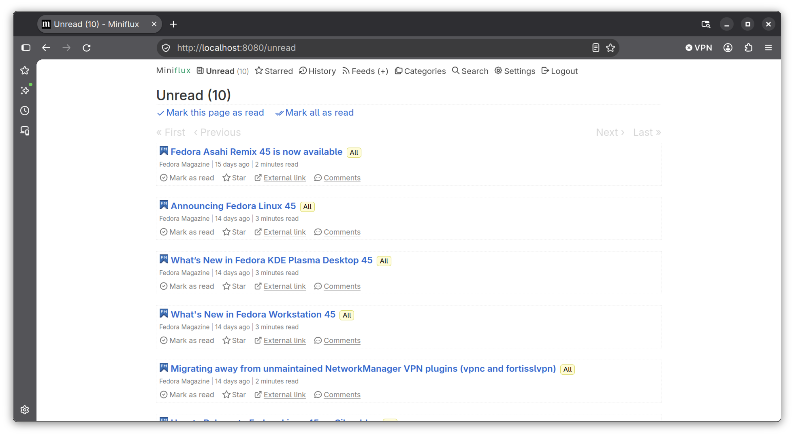
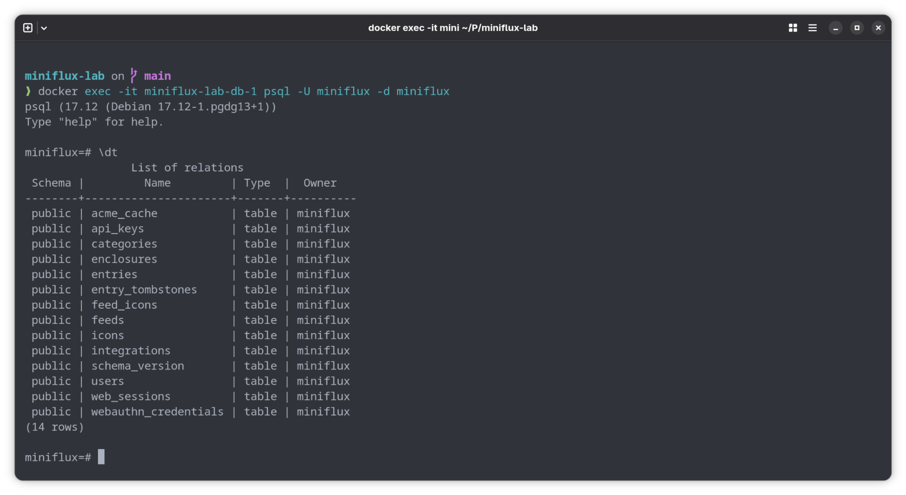

# miniflux-lab

A small Docker Compose lab: the [Miniflux](https://miniflux.app) RSS reader backed by PostgreSQL. I built it to learn how Docker networking works between containers.

## Architecture

```
browser ──127.0.0.1:8080──► miniflux ──"db":5432──► postgres
```

- Two containers on one private network called `backend`.
- Only Miniflux is published to the host. Postgres has no published port, so nothing outside the network can reach it.
- Miniflux finds the database by its service name (`db`) using Docker's built-in DNS.
- Database files live in a named volume, so data survives container removal.

## What this demonstrates

- Service discovery by name on a user-defined bridge network
- Published vs unpublished ports (`ports:` on one service, none on the other)
- Binding a port to `127.0.0.1` so it is not exposed to the local network
- Healthchecks plus `depends_on: condition: service_healthy` for startup order
- Named volumes for persistent data
- Keeping secrets out of Git with `.env` and `.env.example`

## Screenshots

**Service discovery:** `db` resolves to an IP inside the Miniflux container but returns nothing on the host. Both containers share the same private subnet.



**The app running**, with feeds stored in Postgres:



**The tables Miniflux created** in the database:



## Requirements

- Docker with the Compose plugin (`docker compose version` should print a version)

## Quick start

```bash
git clone https://github.com/tamilore-dev/miniflux-lab
cd miniflux-lab
cp .env.example .env
nano .env                # set real passwords
docker compose up -d
docker compose ps        # db should show (healthy)
```

Open http://localhost:8080 and log in as `admin` with the `ADMIN_PASSWORD` from your `.env`.

## Configuration

| Variable | Purpose |
|---|---|
| `POSTGRES_PASSWORD` | Password for the Postgres user `miniflux` |
| `ADMIN_PASSWORD` | Password for the Miniflux `admin` login |

`.env` is ignored by Git. Never commit it.

> Postgres only reads `POSTGRES_PASSWORD` the first time it creates the volume. If you change it later, either keep the old value or reset with `docker compose down -v` (this deletes all data).

## Networking experiments

Inspect the network and list each container's IP:

```bash
docker network inspect -f '{{range .Containers}}{{.Name}} {{.IPv4Address}}{{"\n"}}{{end}}' miniflux-lab_backend
```

Resolve `db` from inside the Miniflux container (works), then from the host (fails):

```bash
docker exec miniflux-lab-miniflux-1 getent hosts db
getent hosts db
```

Query the database interactively:

```bash
docker exec -it miniflux-lab-db-1 psql -U miniflux -d miniflux
```

Try reaching Postgres from the host on port 5432. It should fail, because the port is never published.

## Useful commands

| Command | What it does |
|---|---|
| `docker compose logs -f` | Follow logs from both containers |
| `docker compose down` | Stop and remove containers (data kept) |
| `docker compose down -v` | Also delete the database volume |

## Project structure

```
miniflux-lab/
├── compose.yaml     services, network, volume
├── .env.example     template for secrets
├── .gitignore       keeps .env out of Git
├── images/          README screenshots
└── README.md
```

## Notes

- This is a learning lab, not a production setup. For production, use a secret manager, TLS, backups, and pinned image versions.
- Pin the Miniflux image to a specific version tag instead of `latest` so the lab stays reproducible.
